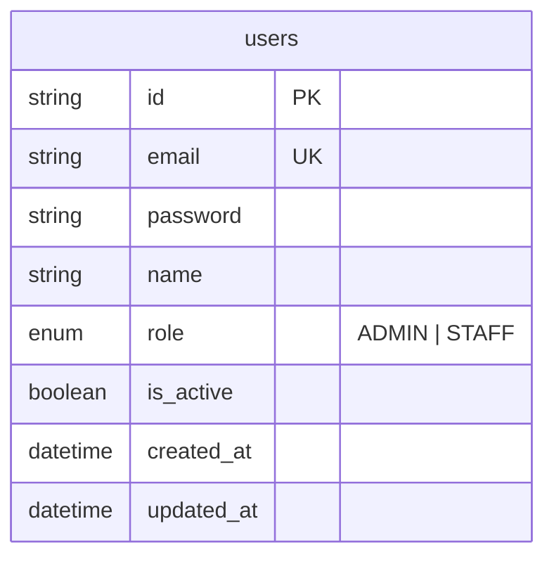
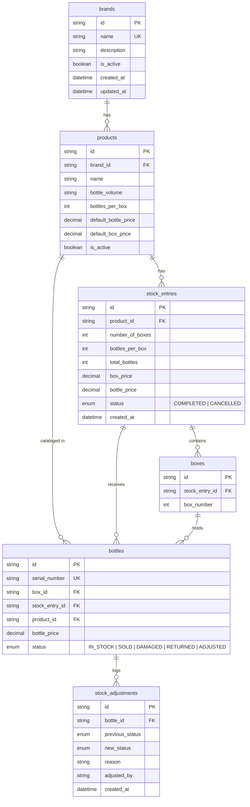
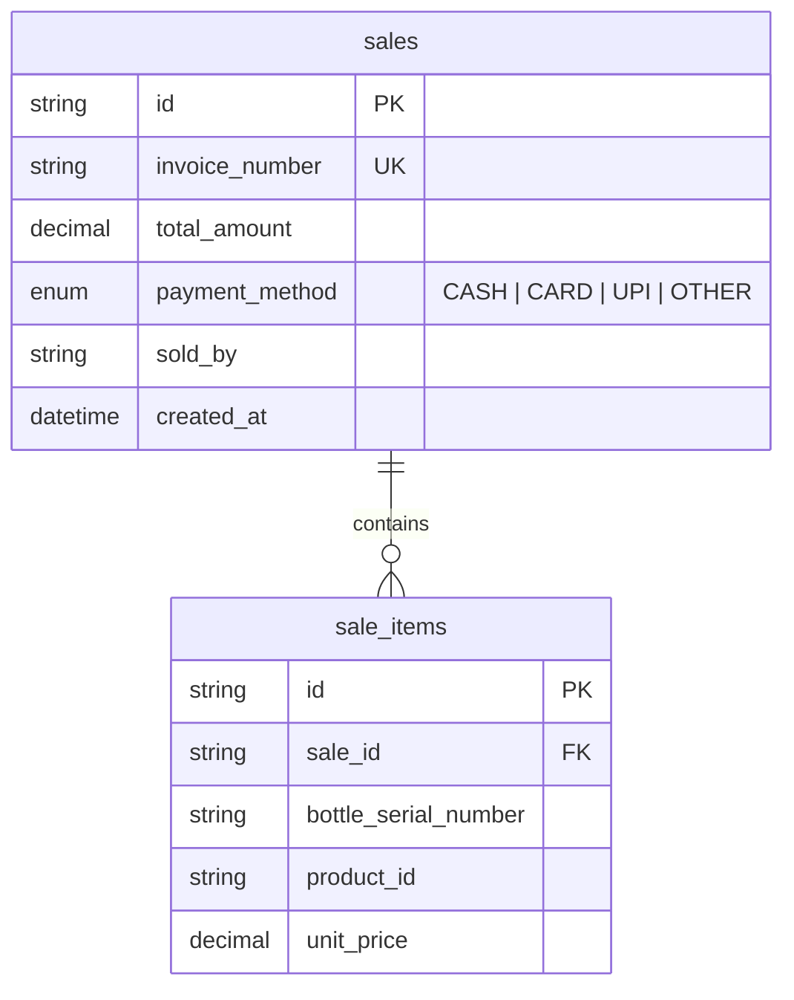

# Wine Shop Management System - Database Architecture (Milestone 2)

## Overview
The Wine Shop Management System uses a **database-per-service** pattern.
Each microservice owns its data in PostgreSQL:
1. `auth_db` — Auth Service
2. `inventory_db` — Inventory Service
3. `sales_db` — Sales Service

---

## Entity Relationship Diagrams (ERD)

### 1. Auth Database (`auth_db`)

---

### 2. Inventory Database (`inventory_db`)

---

### 3. Sales Database (`sales_db`)

---

## Key Constraints & Indexes

1. **Unique Bottle Serial Numbers**: `bottles.serial_number` is globally unique across the system (Rule 3).
2. **Compound Uniqueness**:
   - `products`: `[brand_id, name, bottle_volume]` unique constraint.
   - `boxes`: `[stock_entry_id, box_number]` unique constraint.
3. **Optimized Inventory Lookup Indexes**:
   - `bottles(serial_number)` — fast barcode/serial validation during stock creation & sale scanning.
   - `bottles(status)` — fast stock availability aggregation.
   - `bottles(product_id, status)` — fast stock per product calculation.
   - `sale_items(bottle_serial_number)` — historical trace of sold serial numbers.
4. **Historical Price Preservation**: `bottles.bottle_price` and `stock_entries.bottle_price` lock in exact purchase price at stock reception time (Rule 6).
